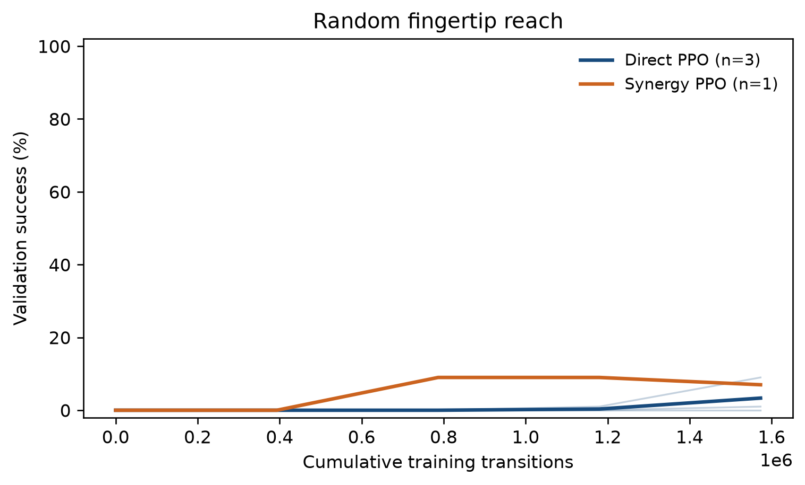
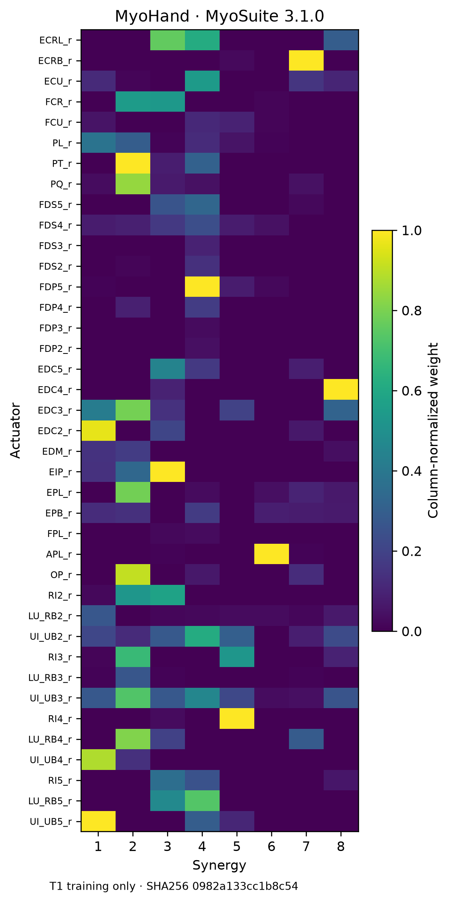

# Myo-RSI v0.1 results

## 1. Setup

NVIDIA GeForce RTX 4060, 8188 MiB, 621.01. Python 3.13.17. Package versions are in [the runtime manifest](runtime-packages.txt).

Normal-body gate True, adaptation gate True. T0 115D observation / 39D action, T1 115D observation / 39D action, T2 108D observation / 39D action, T3 115D observation / 39D action.

Three training seeds (11, 29, 47), 256 environments × 24 steps × 256 iterations per A/B run. C1/C2 receive 64 iterations. Each evaluation uses 100 seeded episodes with deterministic mean actions. Validation seeds generate curves. The disjoint final seeds score the fixed-budget endpoints. Both synergy policies require the identical frozen bank derived from direct T1 training data.

## 2. Table 1. Normal-body final success

| Task | Method | Seeds | Mean ± SD success | Training steps/seed | Mean training GPU h | Status |
|---|---|---:|---:|---:|---:|---|
| T1 | Direct PPO | 3 | 3.0% ± 3.5 pp | 1572864 | 0.063 | RUN |
| T1 | Synergy PPO | 1 | 6.0% | 1572864 | 0.063 | PARTIAL |
| T2 | Direct PPO | 3 | 0.0% ± 0.0 pp | 1572864 | 0.051 | RUN |
| T2 | Synergy PPO | 0 | — | — | — | NOT_RUN |

| Task | Method | Seed | Success | 95% Wilson episode CI |
|---|---|---:|---:|---:|
| T1 | Direct PPO | 11 | 1/100 | 0.2–5.4% |
| T1 | Direct PPO | 29 | 7/100 | 3.4–13.7% |
| T1 | Direct PPO | 47 | 1/100 | 0.2–5.4% |
| T1 | Synergy PPO | 11 | 6/100 | 2.8–12.5% |
| T2 | Direct PPO | 11 | 0/100 | 0.0–3.7% |
| T2 | Direct PPO | 29 | 0/100 | 0.0–3.7% |
| T2 | Direct PPO | 47 | 0/100 | 0.0–3.7% |

## 3. Reach and pose learning curves

## 4. Final success and shared bank

## 5. Table 2. Sarcopenic Reach adaptation

NOT_RUN

NOT_RUN

## 6. Retention and adaptation cost

NOT_RUN

The direct Reach teacher accounts for 4,718,592 training transitions across completed seeds. Excitations were sampled during those rollouts. The ledger charges each source run once. GPU hours are single-device wall allocations. CPU NMF time is recorded separately.

## 7. Interpretation and limitations

Seed SD measures variation across independently trained policies. Wilson intervals describe episode uncertainty within one policy. The small number of training seeds limits precision. See [implementation and numerical limitations](limitations.md).
