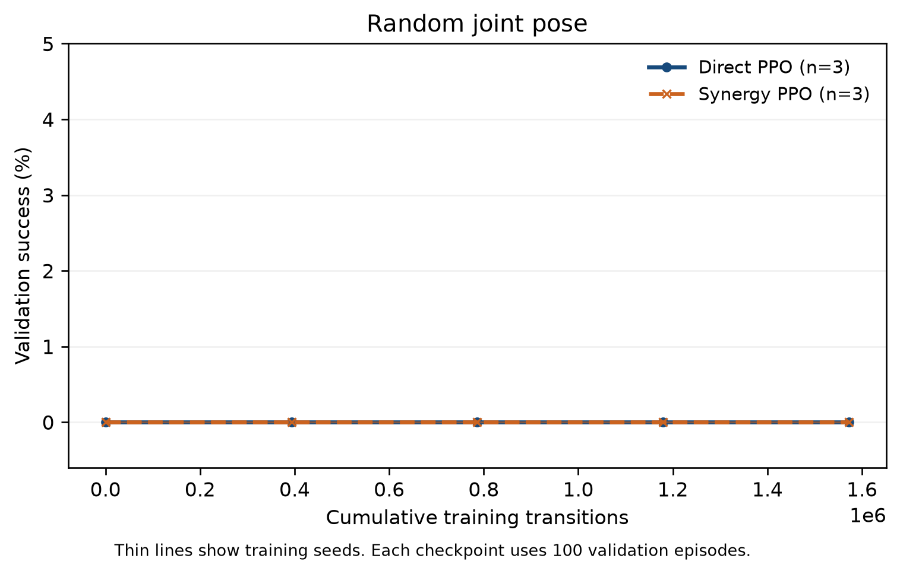
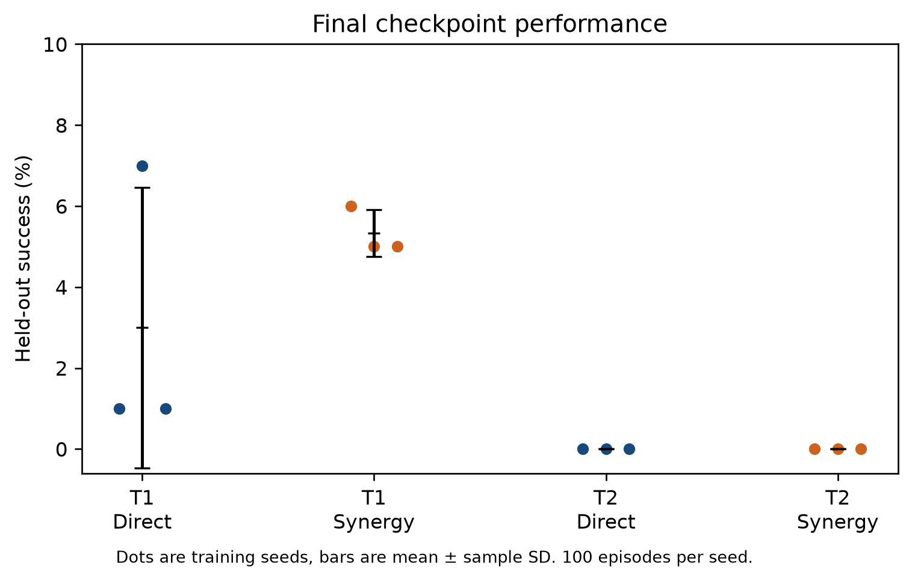
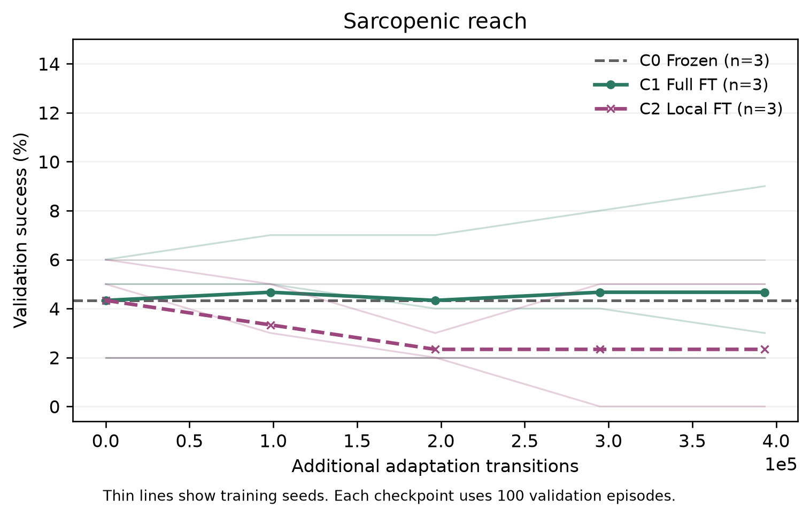
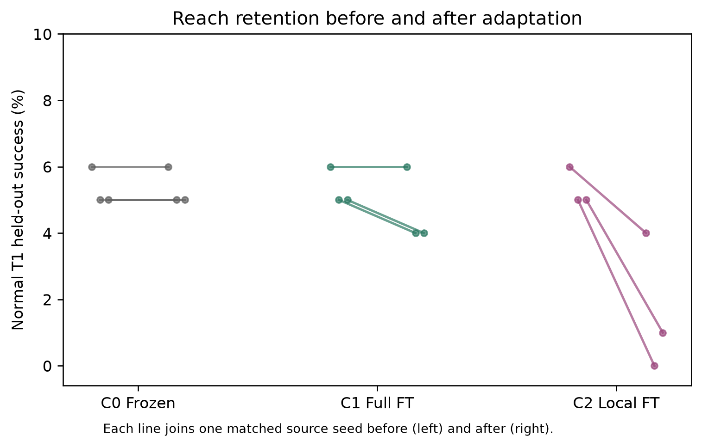
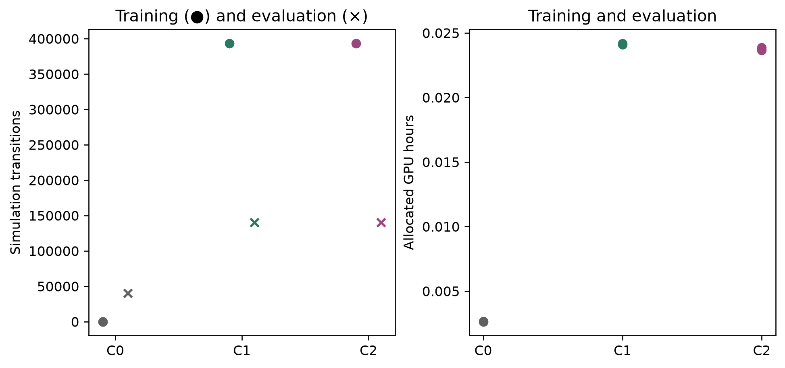

# Myo-RSI v0.1 results

## 1. Setup

NVIDIA GeForce RTX 4060, 8188 MiB, 621.01. Python 3.13.17. Package versions are in [the runtime manifest](runtime-packages.txt).

Normal-body gate True, adaptation gate True. T0 115D observation / 39D action, T1 115D observation / 39D action, T2 108D observation / 39D action, T3 115D observation / 39D action.

Three training seeds (11, 29, 47), 256 environments × 24 steps × 256 iterations per A/B run. C1/C2 receive 64 iterations. Each evaluation uses 100 seeded episodes with deterministic mean actions. Validation seeds generate curves. The disjoint final seeds score the fixed-budget endpoints. Both synergy policies require the identical frozen bank derived from direct T1 training data.

## 2. Table 1. Normal-body final success

| Task | Method | Action dim | Bank source | Seeds | Mean ± SD success | Training steps/seed | Mean training GPU h | Status |
|---|---|---:|---|---:|---:|---:|---:|---|
| T1 | Direct PPO | 39 | none | 3 | 3.0% ± 3.5 pp | 1572864 | 0.063 | RUN |
| T1 | Synergy PPO | 8 | T1 training only | 3 | 5.3% ± 0.6 pp | 1572864 | 0.063 | RUN |
| T2 | Direct PPO | 39 | none | 3 | 0.0% ± 0.0 pp | 1572864 | 0.051 | RUN |
| T2 | Synergy PPO | 8 | T1 training only | 3 | 0.0% ± 0.0 pp | 1572864 | 0.051 | RUN |

| Task | Method | Seed | Success | 95% Wilson episode CI |
|---|---|---:|---:|---:|
| T1 | Direct PPO | 11 | 1/100 | 0.2–5.4% |
| T1 | Direct PPO | 29 | 7/100 | 3.4–13.7% |
| T1 | Direct PPO | 47 | 1/100 | 0.2–5.4% |
| T1 | Synergy PPO | 11 | 6/100 | 2.8–12.5% |
| T1 | Synergy PPO | 29 | 5/100 | 2.2–11.2% |
| T1 | Synergy PPO | 47 | 5/100 | 2.2–11.2% |
| T2 | Direct PPO | 11 | 0/100 | 0.0–3.7% |
| T2 | Direct PPO | 29 | 0/100 | 0.0–3.7% |
| T2 | Direct PPO | 47 | 0/100 | 0.0–3.7% |
| T2 | Synergy PPO | 11 | 0/100 | 0.0–3.7% |
| T2 | Synergy PPO | 29 | 0/100 | 0.0–3.7% |
| T2 | Synergy PPO | 47 | 0/100 | 0.0–3.7% |

## 3. Reach and pose learning curves

## 4. Final success and shared bank

## 5. Table 2. Sarcopenic Reach adaptation

| Source seed | Method | T3 before → after | T1 retention | Additional transitions | Training GPU h |
|---:|---|---:|---:|---:|---:|
| 11 | C0 Frozen | 5% → 5% | 6% | 0 | 0.000 |
| 29 | C0 Frozen | 6% → 6% | 5% | 0 | 0.000 |
| 47 | C0 Frozen | 3% → 3% | 5% | 0 | 0.000 |
| 11 | C1 Full FT | 5% → 7% | 6% | 393216 | 0.016 |
| 29 | C1 Full FT | 6% → 6% | 4% | 393216 | 0.016 |
| 47 | C1 Full FT | 3% → 3% | 4% | 393216 | 0.016 |
| 11 | C2 Local FT | 5% → 6% | 4% | 393216 | 0.015 |
| 29 | C2 Local FT | 6% → 0% | 0% | 393216 | 0.015 |
| 47 | C2 Local FT | 3% → 1% | 1% | 393216 | 0.015 |
| mean ± SD | C0 Frozen | 4.7% → 4.7% ± 1.5% | 5.3% ± 0.6% | — | 0.000 |
| mean ± SD | C1 Full FT | 4.7% → 5.3% ± 2.1% | 4.7% ± 1.2% | — | 0.016 |
| mean ± SD | C2 Local FT | 4.7% → 2.3% ± 3.2% | 1.7% ± 2.1% | — | 0.015 |

## 6. Retention and adaptation cost

The direct Reach teacher accounts for 4,718,592 training transitions across completed seeds. Excitations were sampled during those rollouts. The ledger charges each source run once. GPU hours are single-device wall allocations. CPU NMF time is recorded separately.

## 7. Interpretation and limitations

Seed SD measures variation across independently trained policies. Wilson intervals describe episode uncertainty within one policy. The small number of training seeds limits precision. See [implementation and numerical limitations](limitations.md).

- Random fingertip reach reached 3.0% with direct control and 5.3% with fixed-bank control at matched downstream budgets (synergy minus direct +2.3 percentage points).
- Random joint pose reached 0.0% with direct control and 0.0% with fixed-bank control at matched downstream budgets (synergy minus direct +0.0 percentage points).
- The bank used 3,652 T1 fitting samples. The training-episode holdout relative Frobenius error was 0.501, with 3.1% of reconstructed channel values outside the reachable interval.
- Full and local fine-tuning reached 5.3% and 2.3% mean T3 success. Their original-body retention was 4.7% and 1.7% respectively. Each received 393,216 additional training transitions per seed.
- The local update trained 1,992 actor parameters versus 65,424 for full fine-tuning. Both conditions also updated a critic.
