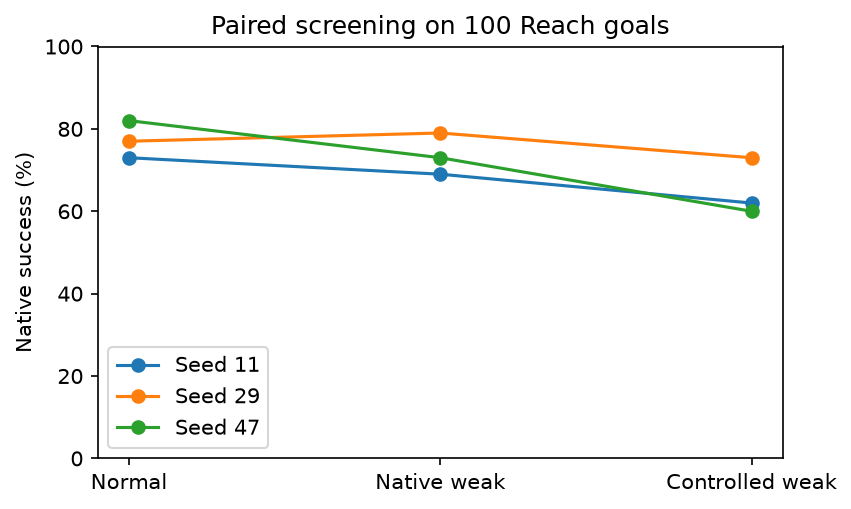
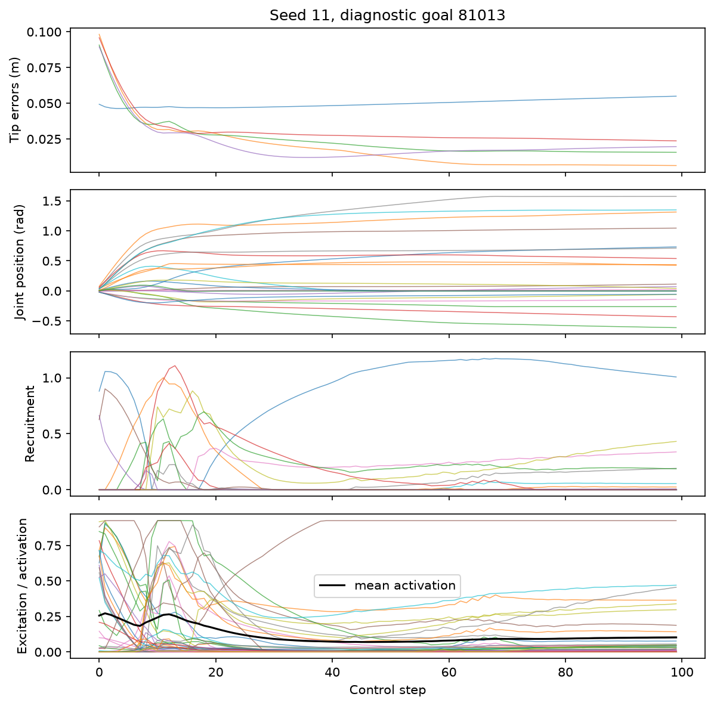
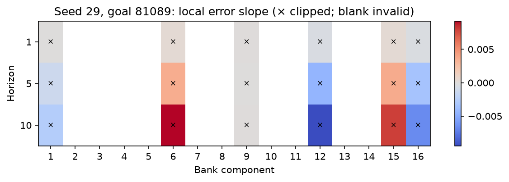
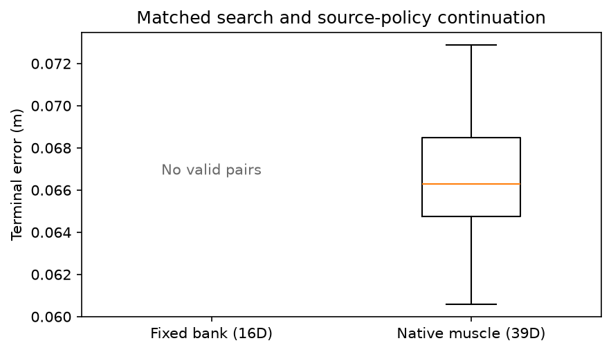
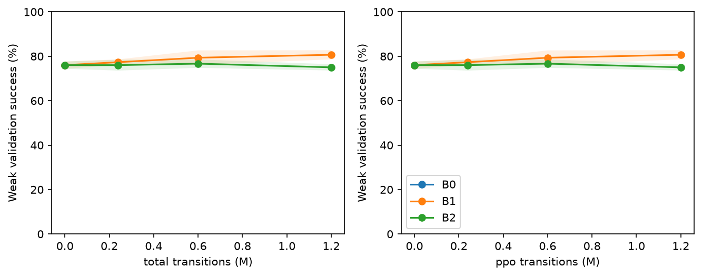
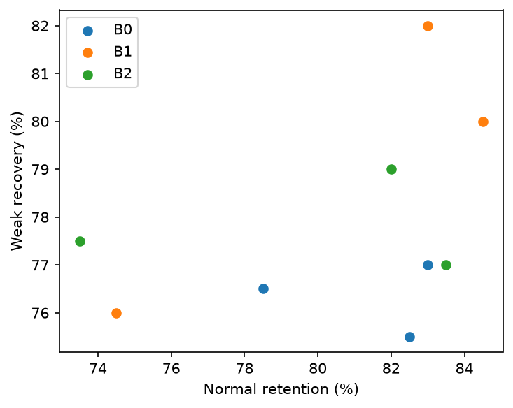
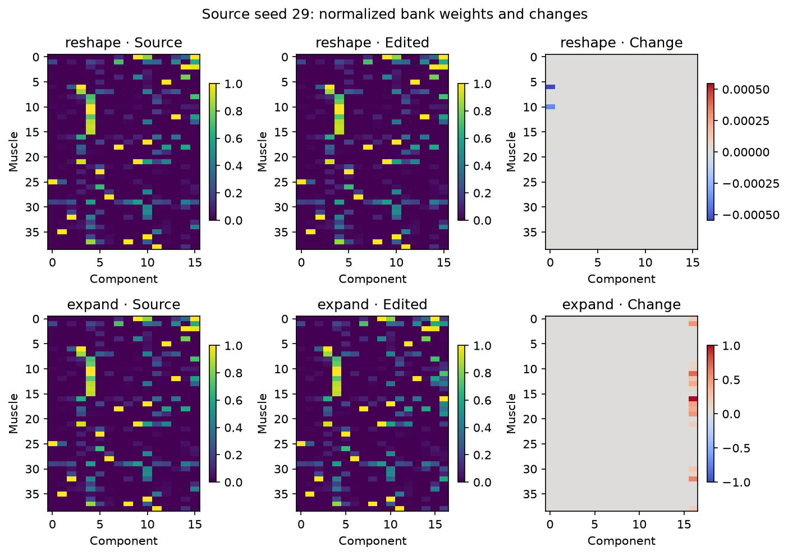
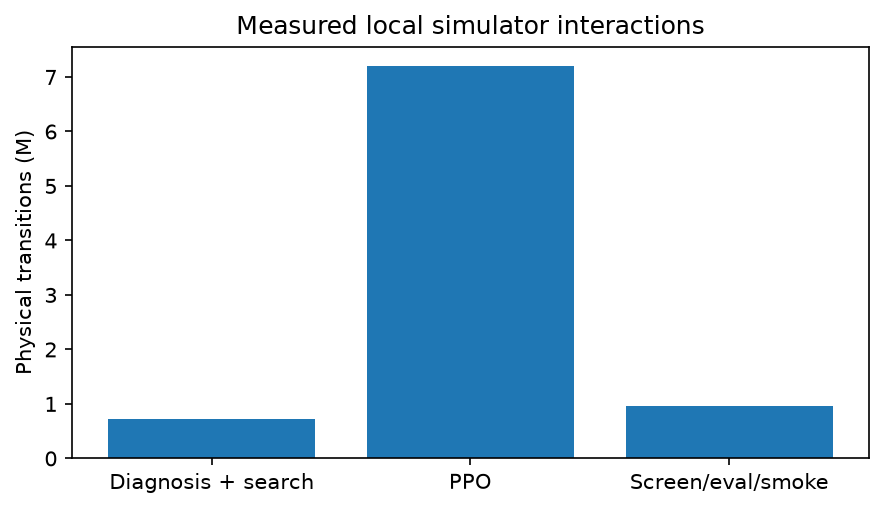

# V0.2a · 弱手诊断与修复

**PARTIAL（存在未完成的主比较）** · 本报告由已保存的逐目标记录生成。

**验证 1 · 肌力变化**　同一批 100 个目标上，三个 16 维源策略的正常手平均成功率为 77.3%，原生肌少症手（正常峰值力的 50%）为 73.7%。预注册的 S2 将全部 39 块肌肉的峰值力设为正常值的 37.5%，平均成功率为 65.0%。S2 达到差距门槛，三个种子都有同物理条件下的 39 维成功参考。

**验证 2 · 固定协同库能否修正失败**　每个源策略记录 100 个诊断目标，按末端误差分层选择 4 个失败和 1 个成功对照，记录最偏离的指尖、误差首次上升及停滞位置。每个分支均从同目标重置并重放原始动作前缀。下表的成功见证要求通过状态匹配检查，并在完整闭环延续后通过原生成功判据。

| 搜索空间 | 尝试 | 通过匹配与对照检查 | 成功见证 | 误差改善候选 |
|---|---:|---:|---:|---:|
| K16 | 3000 | 0 | 0 | 0 |
| muscle39 | 3000 | 153 | 15 | 36 |

共有 5847 个搜索候选未通过物理状态或无干预延续对照检查。功能扰动的 2160 个配对读数中，81 个通过状态检查；发生限幅的响应另有标识。各源策略可用于 BC 的独立失败目标数为 0, 0, 0（种子顺序 11、29、47）。单目标或无目标不能完成跨案例 BC 验证。有限搜索失败无法确定物理可达性或协同库容量上限。

**验证 3 · 等预算适应和旧技能保留**　每个可训练分支从相同种子的 K=16 Reach checkpoint 开始，固定同一个解码库。B1 全量更新策略与价值网络，B2 仅更新募集残差与价值网络。B3 预留 24 万步用于诊断和候选搜索，其余 96 万步用于 PPO。基线 B0 没有新增训练。正常手和 S2 的最终结果均使用锁定的 200 个新目标；均值和标准差跨三个源策略计算。

| 方法 | S2 成功率 %（均值 ± SD） | 相对冻结提升 pp | 正常手成功率 % | 保留变化 pp | S2 验证 AUC % |
|---|---:|---:|---:|---:|---:|
| B0 | 76.3 ± 0.8 | +0.0 | 81.3 ± 2.5 | +0.0 | 76.0 |
| B1 | 79.3 ± 3.1 | +3.0 | 80.7 ± 5.4 | -0.7 | 78.8 |
| B2 | 77.8 ± 1.0 | +1.5 | 79.7 ± 5.4 | -1.7 | 76.0 |

缺少符合条件的完整最终记录：B3/11, B3/29, B3/47。B3 的三种子恢复收益、保留和相对 B1/B2 的优势无法估计。详细原因见各诊断记录。

[逐源策略最终结果与 Wilson 区间](final_performance.csv) · [恢复、保留和配对 95% 区间](summary.csv) · [验证学习曲线数据](adaptation_progress.csv)

**验证 4 · Reshape 与 Expand**　完成 6/6 项独立结构测试。种子、权重来源、首步梯度、初始动作偏差、重新加载后的正常手成功数见[结构测试表](structure_smoke.csv)。每项用相同的 20 个正常手目标做配对评测。缺少合格全肌肉修正方向时，扩维只用工程测试向量验证接口。

**成本**　本地实际记账 8,884,100 次环境交互，其中诊断与搜索 720,000 次、PPO 训练 7,200,000 次，筛查、评测及其他已记录交互 964,100 次。诊断成本包括前缀和续跑，重复引用不重复计费。另复用历史 10 万教师步与每个种子 1,800 万步训练所得源策略。外部教师预训练及设备独占时长未知。未把预算终点当成收敛。

**可复现性与范围**　实际配置、环境版本、模型/协同库哈希、唯一运行 ID、失败与中断记录独立保存。源策略种子为 11、29、47。评测使用原生末步成功，所有方法共享目标和初始状态；配对区间对源种子和目标交叉重采样，三个源种子限制推断精度。本阶段未检验自主操作选择、记忆或多轮迭代改进。

[冻结协议](../../experiments/rsi_v02a/protocol.json) · [所有运行](runs.csv) · [成本明细](resource_ledger.csv) · [筛查](scenario_screen.csv) · [失败分类](failure_clusters.csv) · [全部搜索候选](counterfactual_trials.csv) · [审核](verification.json)

## 结果解读与可复核记录

在相同的 120 万步下，B1 相比冻结策略的弱手恢复为 +3.0 个百分点，正常手变化 -0.7 个百分点。B2 的对应变化为 +1.5 和 -1.7 个百分点。[B2 与 B1 的配对差值及区间](residual_vs_full.csv)

K16 的 3,000 个候选中，339 个候选自身在分支前通过状态容差；把各自的无干预对照也纳入检查后，合格数为 0。39 维的成功见证集中在 1 个源策略与目标组合。比较两种动作空间的搜索能力需要在相同物理状态上同时获得有效对照。[逐案例回放偏差](replay_audit.csv) · [B3 阻断记录](blocked_arms.csv)

结构测试使用 20 个成对的正常手目标。六次测试总计得到 0 个由失败转成功、0 个由成功转失败的配对变化。这一小样本衡量接口改动后的保留，不能据此推断长期性能。[配对保留变化](structural_retention.csv)

在既定最终评测的首个示例目标上，额外记录了正常手和 S2 的原生接触计数，共 600 帧，0 帧发生接触。模型碰撞掩码、显式配对和逐源策略统计见[接触记录](contact_control.csv)。记录接触没有增加环境交互。

[预定示例中两种体模的轨迹首次偏离](exemplar_body_divergence.csv) · [阶段命令和复现说明](../../experiments/rsi_v02a/README.md) · [源模型与体模](source_manifest.json) · [记录字段](data_contract.json)

筛查队列上的 S2 差距为 12.3 个百分点；独立最终队列上的冻结策略差距为 5.0 个百分点。两批目标的结果应分开解读。B1 和 B2 相对冻结策略的弱手恢复区间均覆盖零。

在 300 个诊断回合中有 99 个失败。末端误差最大的指尖最常为 THtip_r，占 57/99 个失败；这项描述不能归因为单一肌肉病因。[逐回合定位](failure_manifest.csv)

B1 每种子 120 万步的平均 PPO 实测用时为 2.93 分钟（三种子标准差 0.01 分钟）。
B2 每种子 120 万步的平均 PPO 实测用时为 2.76 分钟（三种子标准差 0.04 分钟）。

B3 实际 BC 梯度步数和 PPO 交互均为 0。两次未成功的结构冒烟尝试及一次筛查接口错误均保留在运行索引和总成本中。结构重试采用回溯步长训练募集头，并通过显式选择零点的右侧梯度使新通道能在保持初始输出的同时被训练。[成本分类](resource_ledger.csv) · [轨迹时序与解码精度核验](trajectory_integrity.csv)
