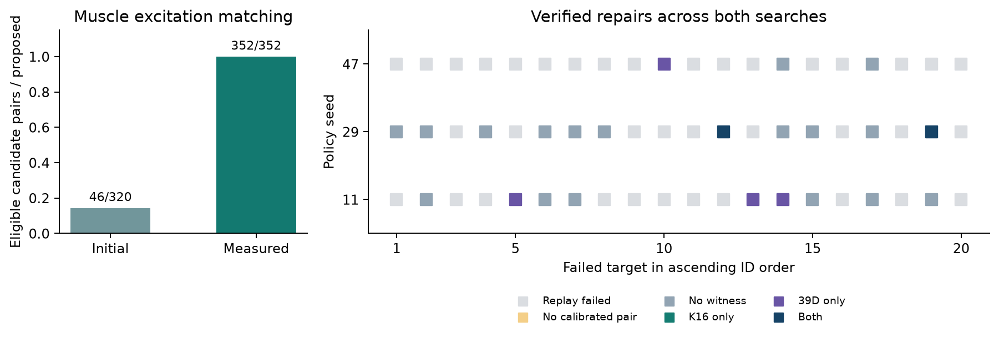

# V0.2a-CF｜相同物理状态下的反事实修复

**K16 重新募集在 2 个独立失败目标上找到并复现了修正。** 39D 肌肉搜索修复了 6 个目标，其中 4 个只有 39D 找到修正。两轮使用同一批开发目标。按物理目标去重，60 个失败中 23 个至少一次通过严格回放，23 个获得合格的等强度候选对。

## 回放与修复结果

| 策略种子 | 独立失败目标 | 两次无干预回放通过¹ | 有合格候选对 | K16 修复 | 39D 修复 | 仅 39D 修复 |
|---:|---:|---:|---:|---:|---:|---:|
| 11 | 20 | 9 | 9 | 0 | 3 | 3 |
| 29 | 20 | 11 | 11 | 2 | 2 | 0 |
| 47 | 20 | 3 | 3 | 0 | 1 | 1 |

¹ 同一实验、同一条恢复路径的两次回放均需通过；同一目标跨轮仅计一次。每个种子另保留 4 个原本成功的目标作对照。

在有可比候选的目标内，0 个仅 K16 修复，2 个两组都修复，4 个仅 39D 修复，17 个两组都未找到修正。有限搜索无法排除其他修正路径，也无法由这些开发目标估计跨目标泛化。

**Reuse。** 目标 102041、102059 已由固定 K16 Bank 的新募集路径修复，可保留现有 Bank。

**潜在表示缺口。** 目标 101015、101033、101034、103030 只出现 39D 成功修正，可用于后续 Same-K Reshape 或 Expand 验证。当前结果不足以证明 K16 无解。

## 为什么做两轮等预算搜索

首轮在 39D 轨迹自身的闭环观测上估算 K16 会产生多大的扰动。两组轨迹分开后，实际扰动可能超过配对误差限。第二份协议在看到该问题后冻结，完整重跑三个种子。39D 使用成对 K16 实际 rollout 同一步的 excitation 差向量范数和饱和肌肉数，方向仍在 39 维独立采样。两轮按原容差审核实际 ctrl，所有候选均闭环运行至原生终点。

| 阶段 | 回放通过的失败目标 | 至少一对有效候选的目标 | 校准候选对 / 提出 | K16 修复目标 | 39D 修复目标 | 正式交互数 |
|---|---:|---:|---:|---:|---:|---:|
| 首轮 | 20 | 19 | 46/320 (14.4%) | 2 | 1 | 702,000 |
| 实测幅度复验 | 22 | 22 | 352/352 (100.0%) | 2 | 6 | 702,000 |

每轮每个合格目标每组 16 个候选，每个候选独立执行两遍。K16 与 39D 共用原始状态、75 步分支点、10 步干预、15 步后续闭环和每个种子的仿真预算。比较使用 39 块肌肉的实际 excitation。

## 物理重放审计

保存 MuJoCo 全积分状态，包括位置、速度、肌肉 activation、ctrl、warm-start 和时间，同时恢复任务目标、计数器、动作缓冲及随机源。原 world lane 与批宽固定。刷新观测缓存后重新计算策略输入；所有无干预闭环均逐步检查原始容差。快照失败的目标再用同一初始化与记录的原动作前缀复验。

| 阶段 | 路径 | 对照次数 | 分支状态全部合格 | 终局判据及 1 mm 合格 | 整段轨迹合格 | 终点最大偏差（mm） |
|---|---|---:|---:|---:|---:|---:|
| 首轮 | integration | 144 | 144 | 144 | 48 | 0.0265 |
| 首轮 | prefix | 100 | 12 | 100 | 0 | 0.0952 |
| 实测幅度复验 | integration | 144 | 144 | 144 | 53 | 0.0234 |
| 实测幅度复验 | prefix | 94 | 7 | 94 | 0 | 0.2872 |

终局一致仍可能伴随中途速度、肌肉 excitation 或积分 warm-start 超限。无干预对照逐变量通过后才启动该目标的搜索。按协议的误差分布和成功对照记录见分轮报告。

## 修正数据与成本

**B3 状态为 BLOCKED。** 三个种子的独立 K16 修复目标数为 0、2、0；门槛为每个种子至少 2 个。已验证 K16 轨迹含观测、原始和修正募集量、身体状态、目标、终局及来源，已按物理目标哈希统一划分训练和验证。

正式实验消耗 1,404,000 次仿真交互，搜索两组各 576,000 次。含两次工程预检和中途失败尝试共 **1,448,920 次**。每个填充环境、前缀重放、原始筛查及重复验证均计费。每个阶段的实测耗时列在资源账本。

B3 未启动 BC 或局部 PPO，本轮没有新增可与历史 B1/B2 对比的训练成绩。

## 图表与记录

[首轮完整报告](initial_search/RESULTS_REPORT.md) · [实测幅度复验完整报告](paired_excitation/RESULTS_REPORT.md) · [历史 V0.2a 结果](../RESULTS_REPORT.md)

[回放误差](figures/replay_state_error.png) · [回放有效率](figures/replay_validity_rate.png) · [K16/39D 搜索成功](figures/search_success.png) · [复验逐目标修复](figures/goal_repairs.png) · [终点误差改善](figures/terminal_improvement.png) · [复验成本](figures/simulation_cost.png)

[回放审计](replay_audit.csv) · [分种子搜索](search_summary.csv) · [全部候选](counterfactual_trials.csv) · [独立目标判别](functional_gap_summary.csv) · [成功见证](verified_witnesses.csv) · [BC 数据及统一划分](bc_dataset.csv) · [资源账本](resource_ledger.csv) · [全部运行与哈希](runs.csv) · [机器核验](verification.json)
