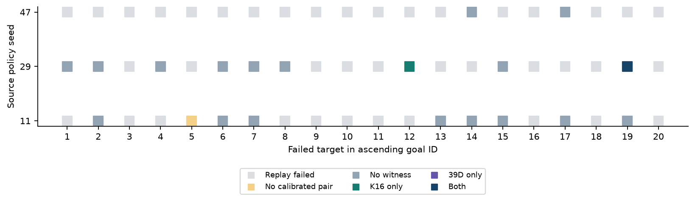
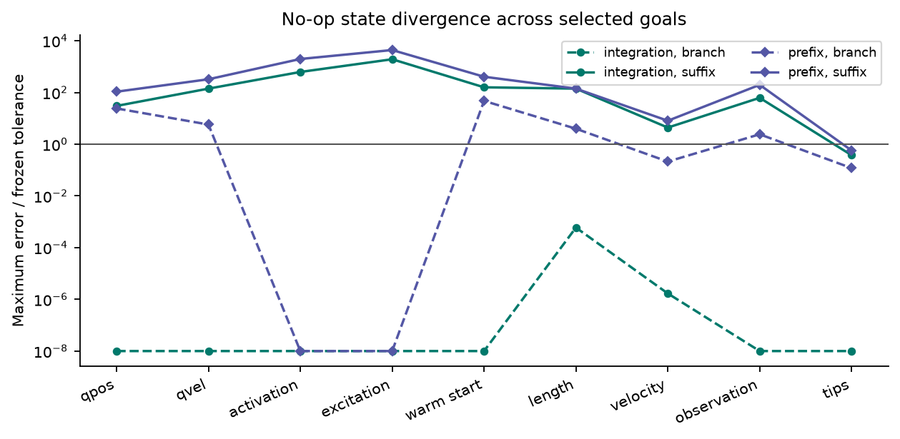
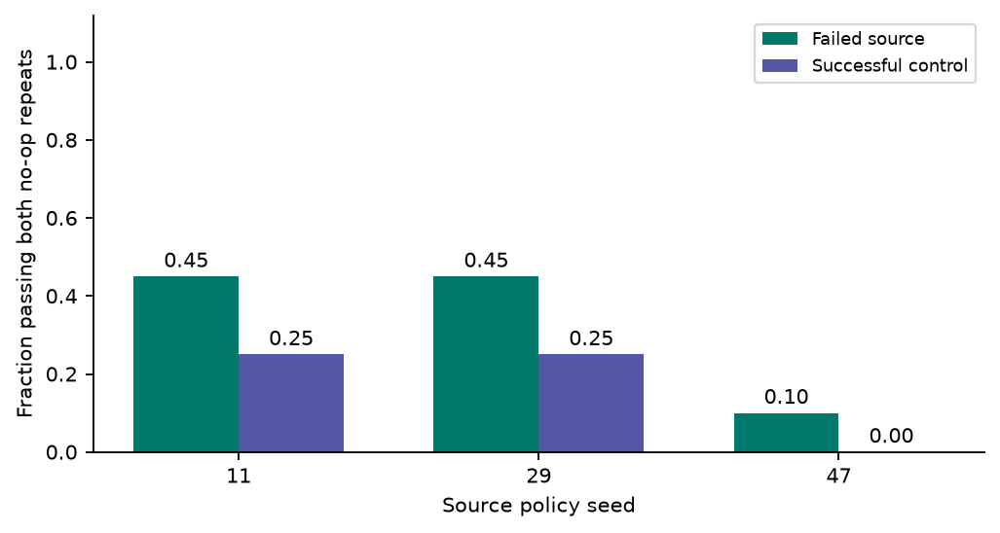
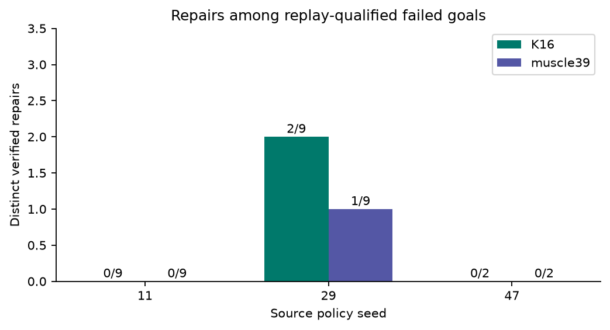
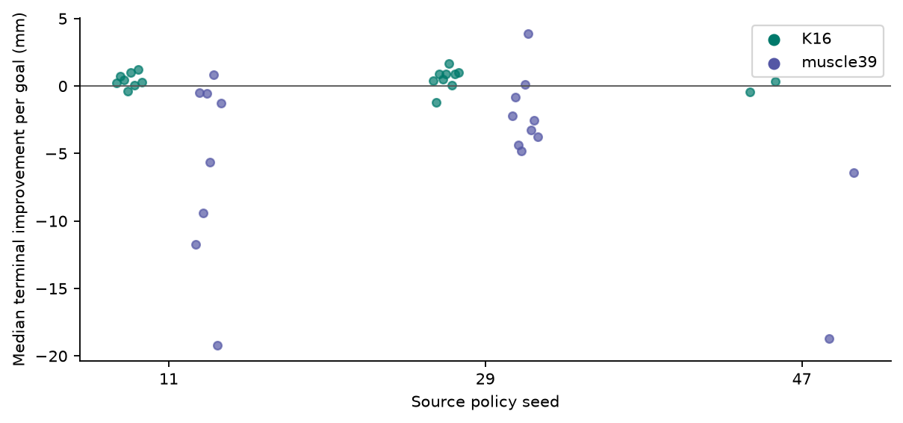
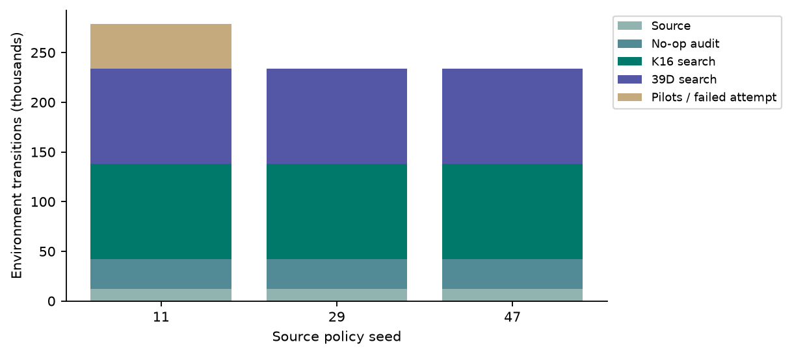

# V0.2a-CF | S2 反事实搜索验证

在三个冻结的 K16 PPO 策略上，60 个不同的原始失败目标中，**20 个通过两次严格回放**，19 个有合格的配对候选。K16 募集搜索在 **2 个目标**上复现成功修正，39 维肌肉搜索在 **1 个目标**上复现成功修正。其中 0 个只有 39D 找到修正。

**B3 门控为 BLOCKED。** 三个策略种子的合格 K16 修复目标数依次为 0、2、0，每个种子的最低要求为 2。

## 按独立失败目标比较

| Policy seed | 失败目标 | 回放通过 | 有合格候选对 | K16 成功候选 / 修复目标 | 39D 成功候选 / 修复目标 | 仅 39D 修复 | 两组均未找到 |
|---:|---:|---:|---:|---:|---:|---:|---:|
| 11 | 20 | 9 | 8 | 0 / 0 | 0 / 0 | 0 | 8 |
| 29 | 20 | 9 | 9 | 2 / 2 | 1 / 1 | 0 | 7 |
| 47 | 20 | 2 | 2 | 0 / 0 | 0 / 0 | 0 | 2 |

修复要求同一候选在两次独立恢复后均通过原生终局成功判据，终点误差之差 ≤1 mm，且两组扰动通过物理尺度匹配。两组均未找到只适用于有合格候选的目标。只有 39D 成功提示潜在表示缺口，仍需 Same-K Reshape 或 Expand 验证。

## 回放可信度

固定 S2 肌力、原 Checkpoint 和 Bank。在新的开发目标上保留原始 world lane 与批宽。第 75 步先恢复 MuJoCo 全积分状态、肌肉状态、动作及命令缓冲、目标、计数器和随机状态，刷新派生观测。若同一目标无法通过两次无干预对照，再从相同初始化重放保存的 75 步原动作。后续 25 步使用冻结策略闭环。

沿用历史绝对容差，并逐步检查全部后续状态。每次对照同时要求原生成功标志相同且终点误差差值 ≤1 mm。误差表中的 suffix 是整段轨迹逐变量的最大绝对误差。零宽状态字段记录在各次运行清单内。

| 路径 | 对照次数 | 分支所有变量通过 | 原生终局及 1 mm 通过 | 全轨迹通过 | 终点差中位数 / 最大值（mm） |
|---|---:|---:|---:|---:|---:|
| integration | 144 | 144 | 144 | 48 | 0.0002 / 0.0265 |
| prefix | 100 | 12 | 100 | 0 | 0.0031 / 0.0952 |

第二条路径只用于第一条路径未通过的目标。分母包含成功对照和失败目标的重复测量。按目标需要同一条路径两次都通过。

## 搜索预算、强度及终点变化

每个合格目标每组 16 个随机候选，每个候选从同一分支独立执行两次。前 10 步分两个 5 步动作块，其后由原策略闭环到第 100 步。39D 方向独立采样，在实际 excitation 空间匹配 K16 扰动的范数及饱和数；每次比较都读取仿真器实际 ctrl。两组平均 RMS 差需 ≤0.01，动作饱和比例差需 ≤0.05。达不到尺度匹配的候选仍保留其终局记录。

| Seed | 动作空间 | 有效配对候选 / 全部失败目标候选 | Excitation RMS 中位数 | 平均饱和比例 | 终点误差改善中位数（mm） |
|---:|---|---:|---:|---:|---:|
| 11 | K16 | 13 / 144 | 0.0803 | 0.1874 | 0.7046 |
| 11 | muscle39 | 13 / 144 | 0.0759 | 0.1937 | -1.2725 |
| 29 | K16 | 30 / 144 | 0.1249 | 0.1837 | 0.8636 |
| 29 | muscle39 | 30 / 144 | 0.1276 | 0.2056 | -2.5849 |
| 47 | K16 | 3 / 32 | 0.1839 | 0.1453 | -0.3161 |
| 47 | muscle39 | 3 / 32 | 0.1763 | 0.1291 | -12.0998 |

误差改善为原始失败终点误差减去干预终点误差，正数表示更接近目标。表内以候选为单位；下图先在同一目标内取中位数，再显示各独立目标。成功对照另列于 search_summary.csv。

## 仿真成本与证据范围

| Seed | 原始筛查 | 无干预回放 | K16 搜索 | 39D 搜索 | 预检及失败尝试 | 全部交互 |
|---:|---:|---:|---:|---:|---:|---:|
| 11 | 12,000 | 30,000 | 96,000 | 96,000 | 44,920 | 278,920 |
| 29 | 12,000 | 30,000 | 96,000 | 96,000 | 0 | 234,000 |
| 47 | 12,000 | 30,000 | 96,000 | 96,000 | 0 | 234,000 |

正式实验共 702,000 次交互；含所有工程预检和失败尝试共 **746,920** 次。每个未参与搜索的填充 lane 也按实际步数计费。resource_ledger.csv 包含每阶段实测墙钟时间。未重新拟合 Bank 或训练源 PPO。

对照通过率衡量这套后端、该批宽和该分支时刻的可重复性。被排除的目标没有可解释的干预结果，搜索的修复率仅适用于通过回放的子集。候选共享同一物理目标，不能作为独立样本估计泛化。

## 数据与复现

[冻结协议](../../../../experiments/rsi_v02a/counterfactual_validation/protocol.json) · [全部运行、代码 Commit 与模型哈希](runs.csv) · [运行清单与原始记录](../runs/) · [机器核验](verification.json)

[逐次回放](replay_audit.csv) · [逐变量误差及通过率](replay_error_summary.csv) · [逐候选终局](counterfactual_trials.csv) · [按种子搜索](search_summary.csv) · [按目标判别](functional_gap_summary.csv) · [已验证修正及 BC 分区](verified_witnesses.csv) · [资源账本](resource_ledger.csv)

B3 停在数据门槛。未启动 BC 或 Local PPO，本轮没有新增 B3 对 B1/B2 的同预算成绩。
