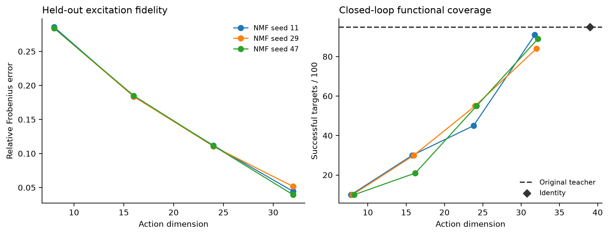
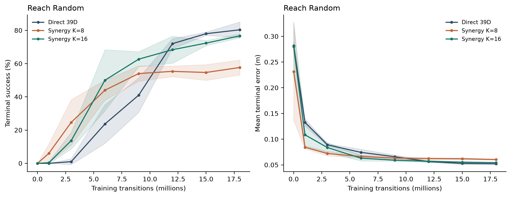
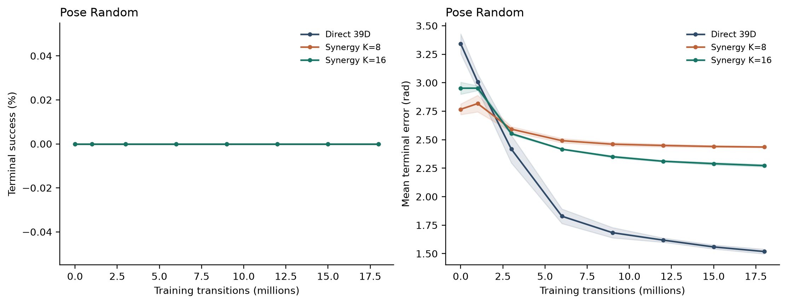
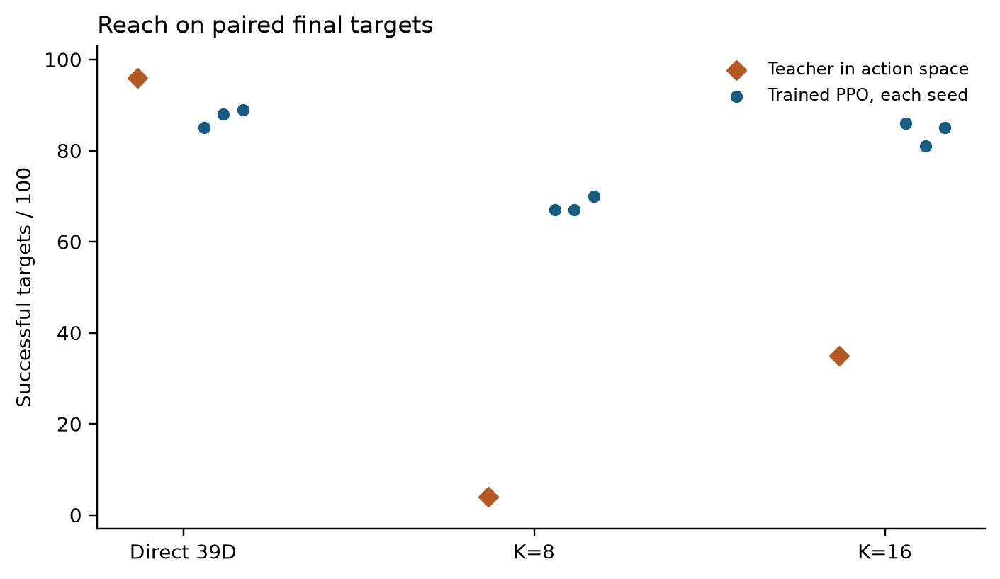
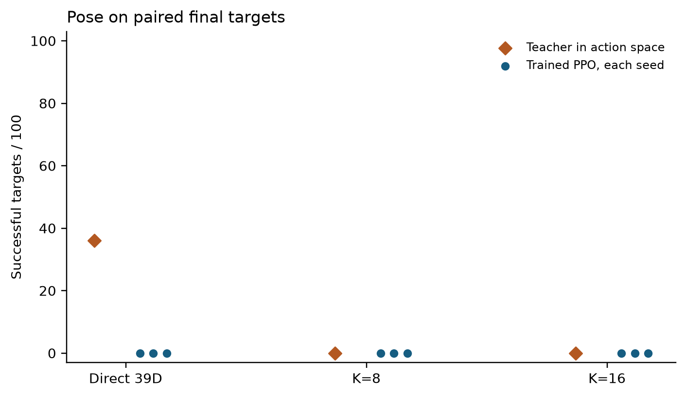

# Complete results · Synergy representation and matched-budget PPO

## Experiment

The unit of training comparison is a policy seed. The deterministic evaluation unit is a complete target episode. Direct PPO controls 39 native muscle actions. Synergy PPO samples a K-dimensional Gaussian action and decodes train-calibrated nonnegative recruitment through an immutable Reach NMF bank. Each actor and critic starts from scratch. The Pose actors are initialized separately and reuse the same frozen Reach weights.

[Configuration and decision rules](../../experiments/synergy_budget/protocol.json) · [Registered environment settings and source manifests](config) · [Original teacher provenance](../v0_1r/teacher_manifest.json)

All arms within a task use 500 environments, 24 transitions per rollout, the task-native reward and observation, the same RSL-RL PPO hyperparameters, training seeds 11/29/47 and equal checkpoint spacing. Development targets for projection were 25000–25099, curve-validation targets 61000–61099 and fresh final targets 71000–71099. Any common extension reinitializes the simulator for all arms and restores model, normalizer, optimizer and learning rate. Full per-cell configurations, checkpoint hashes and per-episode records are in [cells](cells).

## Projection and representation

On the paired development targets the original teacher succeeded on 95/100. The identity control traversed the same numerical projection, conversion and simulator path. The teacher-repeat condition measures baseline trajectory variation. The following triplets follow NMF seeds 11, 29 and 47.

| K | Held-out relative error | Closed-loop successes / 100 |
|---|---|---|
| 8 | 0.286/0.284/0.284 | 10/10/10 |
| 16 | 0.184/0.184/0.185 | 30/30/21 |
| 24 | 0.112/0.111/0.111 | 45/55/55 |
| 32 | 0.044/0.052/0.039 | 91/84/89 |

[Paired functional coverage](functional_coverage.csv) · [Bank heatmaps](figures/bank_heatmap.png) · [Joint and excitation trajectories](figures/paired_trajectories.png)

For bank seed 11, the following onset is the first of three consecutive 20 ms steps at which joint RMS deviation reached 0.02 rad. The named joint had the largest deviation in the greatest number of diverged episodes at their own onset.

| K | Diverged / 100 | Median first step | Most frequent joint |
|---|---|---|---|
| 8 | 100 | 2.0 | flexion_r |
| 16 | 100 | 2.0 | cmc_flexion_r |
| 24 | 100 | 3.0 | cmc_flexion_r |
| 32 | 100 | 9.0 | pm3_flexion_r |

[Per-target first muscle and joint deviations](divergence_targets.csv) · [Offline identity verification](identity_holdout.json)

## Learned control on held-out targets

### Reach Random

| Policy | Successes / 100 for seeds 11, 29, 47 | Mean % ± seed SD (pp) | Terminal error (m) | Transitions per seed |
|---|---|---|---|---|
| Direct 39D | 85/88/89 | 87.3 ± 2.1 | 0.0508 | 18M |
| Synergy K=8 | 67/67/70 | 68.0 ± 1.7 | 0.0577 | 18M |
| Synergy K=16 | 86/81/85 | 84.0 ± 2.6 | 0.0532 | 18M |

[Final individual-seed comparison](figures/T1_final_success.png)

Synergy K=8 minus Direct PPO was -19.3 pp on the independent test (exploratory crossed seed/target bootstrap 95% interval -27.0 to -12.0 pp).

Synergy K=16 minus Direct PPO was -3.3 pp on the independent test (exploratory crossed seed/target bootstrap 95% interval -10.0 to +3.7 pp).

### Pose Random

| Policy | Successes / 100 for seeds 11, 29, 47 | Mean % ± seed SD (pp) | Terminal error (rad) | Transitions per seed |
|---|---|---|---|---|
| Direct 39D | 0/0/0 | 0.0 ± 0.0 | 1.5121 | 18M |
| Synergy K=8 | 0/0/0 | 0.0 ± 0.0 | 2.3844 | 18M |
| Synergy K=16 | 0/0/0 | 0.0 ± 0.0 | 2.2066 | 18M |

[Final individual-seed comparison](figures/T2_final_success.png)

Synergy K=8 and Direct PPO had identical binary outcomes on every paired target and training seed. The bootstrap is degenerate. Continuous error and per-policy Wilson intervals are reported separately.

Synergy K=16 and Direct PPO had identical binary outcomes on every paired target and training seed. The bootstrap is degenerate. Continuous error and per-policy Wilson intervals are reported separately.

## Training specifically for the action space

Reach Random, Synergy K=8 achieved 68.0% mean trained success against 4% for the corresponding teacher controller on the same targets.

Reach Random, Synergy K=16 achieved 84.0% mean trained success against 35% for the corresponding teacher controller on the same targets.

Reach Random, Direct 39D achieved 87.3% mean trained success against 96% for the corresponding teacher controller on the same targets.

Pose Random, Synergy K=8 achieved 0.0% mean trained success against 0% for the corresponding teacher controller on the same targets.

Pose Random, Synergy K=16 achieved 0.0% mean trained success against 0% for the corresponding teacher controller on the same targets.

Pose Random, Direct 39D achieved 0.0% mean trained success against 36% for the corresponding teacher controller on the same targets.

[Target-level gains and losses per training seed](trained_vs_projected.csv) · [Pose teacher reference](pose_projection_test/summary.csv)

## Sample efficiency and stability

| Task | Policy | Mean success AUC through 12M (%) | Mean success AUC through 18M (%) | Seeds reaching 25% by 12M | Seeds reaching 50% by 12M |
|---|---|---|---|---|---|
| Reach Random | Direct 39D | 25.4 | 42.6 | 3/3 | 3/3 |
| Reach Random | Synergy K=8 | 37.3 | 43.4 | 3/3 | 3/3 |
| Reach Random | Synergy K=16 | 39.6 | 50.5 | 3/3 | 3/3 |
| Pose Random | Direct 39D | 0.0 | 0.0 | 0/3 | 0/3 |
| Pose Random | Synergy K=8 | 0.0 | 0.0 | 0/3 | 0/3 |
| Pose Random | Synergy K=16 | 0.0 | 0.0 | 0/3 | 0/3 |

AUC is the trapezoidal integral of deterministic validation success divided by the interaction horizon. Threshold times are the first observed checkpoints reaching each rate. A blank threshold is right-censored. Curve bands represent one standard deviation across training seeds. [Per-seed efficiency](sample_efficiency.csv) · [Learning curves and endpoint Wilson intervals](learning_curves.csv)

## Budget decision and costs

Reach Random used 18,000,000 interactions per arm per seed. Validation success changes from 6M to 12M were K=39 +48.3 pp, K=8 +11.3 pp, K=16 +18.3 pp. The finite resource ceiling leaves convergence unestablished.

Pose Random used 18,000,000 interactions per arm per seed. Validation success changes from 6M to 12M were K=39 +0.0 pp, K=8 +0.0 pp, K=16 +0.0 pp. The finite resource ceiling leaves convergence unestablished.

Descriptive changes over the final two observed intervals are listed below. Continued improvement or variable behavior leaves a longer matched run warranted to assess asymptotic performance. Flat local behavior alone is insufficient to establish convergence. [Late learning trends](late_learning_trends.csv)

| Task | Action dimension | Last three checkpoints | Observed pattern |
|---|---|---|---|
| T1 | 39 | 12000000/15000000/18000000 | mixed or variable |
| T1 | 8 | 12000000/15000000/18000000 | locally flat at measured checkpoints |
| T1 | 16 | 12000000/15000000/18000000 | continued improvement |
| T2 | 39 | 12000000/15000000/18000000 | locally flat at measured checkpoints |
| T2 | 8 | 12000000/15000000/18000000 | locally flat at measured checkpoints |
| T2 | 16 | 12000000/15000000/18000000 | locally flat at measured checkpoints |

A host session interruption caused an extra simulator reset in an initial Pose Direct run. That run and its validation were archived and excluded. Its replacement started from zero at the same seed. The ledger includes measured recovery overhead as a lower bound.

Recorded PPO training consumed 324,000,000 transitions and 9.42 aggregate measured training wall hours. Across all locally measured training, evaluation, projection and excluded recovery rows, the ledger records a lower bound of 338,120,000 new transitions. Demonstrations contributed 100,000 separate historical teacher transitions. The ledger separates new and reused NMF fits, evaluations, projection diagnostics and the zero BC budget. The first Reach run shared the GPU briefly with capacity diagnostics and early checkpoint evaluation. The first Pose run overlapped the independent Reach projection test. Host wall time includes this contention. Device-active time and external teacher pretraining are unknown. [Resource ledger](resource_ledger.csv)

## Interpretation

Reach Random, K=8: the mean validation AUC difference through 12M was +11.9 points. At the common final budget the one-sided lower 95% bound for the paired success difference was -25.7 pp, which does not meet the exploratory −5 pp near-direct criterion.

Reach Random, K=16: the mean validation AUC difference through 12M was +14.2 points. At the common final budget the one-sided lower 95% bound for the paired success difference was -9.0 pp, which does not meet the exploratory −5 pp near-direct criterion.

Pose Random, K=8: mean validation AUC difference through 12M was +0.0 points. Identical final binary outcomes preclude an informative paired bootstrap interval or a near-direct inference.

Pose Random, K=16: mean validation AUC difference through 12M was +0.0 points. Identical final binary outcomes preclude an informative paired bootstrap interval or a near-direct inference.

Projected-teacher control minimizes immediate excitation error on states reached by that controller. PPO learns feedback specifically in its own action space. Their gap can indicate controller adaptation or optimization effects. These experiments do not identify the optimum possible in a bank. A frozen Reach bank contains external teacher information; the scratch comparison measures downstream interaction efficiency conditional on that prior. Three seeds limit claims about superiority and equivalence. Target sharing induces dependence across policies; paired estimates use crossed resampling of seed and target. The study contains no behavior cloning or agent-driven adaptation.

[Release audit of matched cohorts, checkpoints and interaction budgets](verification.json)
