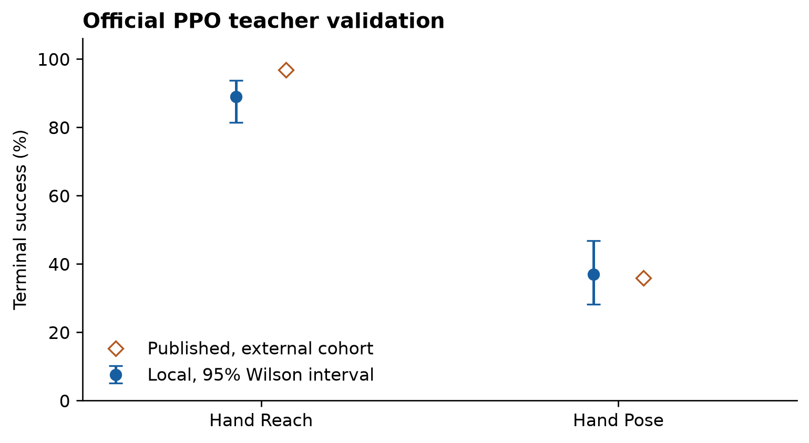
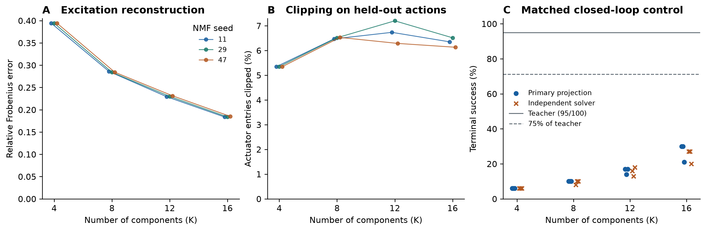
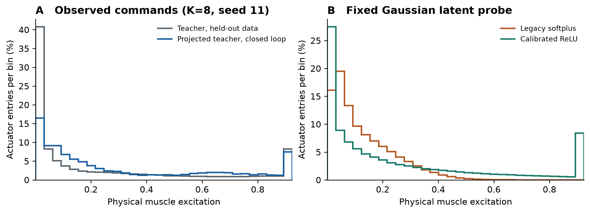
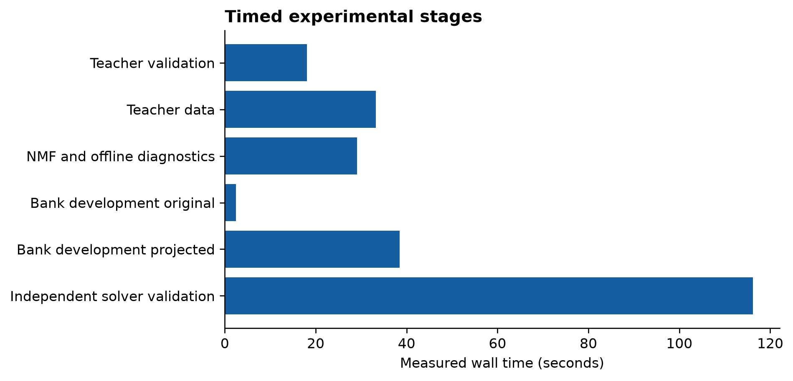

# Myo-RSI v0.1r experimental results

**The official Reach teacher passed local validation (89/100). None of the 12 Reach-derived NMF banks passed closed-loop validation.** On a second cohort the unmodified teacher achieved 95/100. The best projected teacher achieved 30/100 with the primary solver and 27/100 with the independent solver. The protocol stopped at P2 with `BANK_INADEQUATE`. All percentages below use terminal task-native success.

## 1. Setup and scope

We used an GeForce RTX 4060 (8,188 MiB), MyoSuite 3.1.0, mjlab 1.6.1, MuJoCo and MuJoCo Warp 3.11.0, RSL-RL 5.4.2, and the preserved v0.1 source at `9d43a66721f83d45eaca8263741fed57f4b25542`. All eight task/backend combinations passed the fresh environment probe. All 39 muscles had the same actuator order, a 20 ms control step, and a native excitation mapping of `sigmoid(5 × (clip(action, −1, 1) − 0.5))`. The largest absolute mapping error across the eight traces was 5.09 × 10⁻⁸. Reach uses final stacked five-tip L2 error <0.0625 m. Pose uses final joint-pose L2 error <0.7 rad. The audit of the prior study verified all 21 checkpoint hashes. [Environment manifest](tables/env_manifest.csv) · [Historical audit](historical_audit.json) · [Runtime](runtime.json)

The study distinguishes teacher compatibility, offline action fidelity and closed-loop controllability. A frozen teacher used the current state at each step. Reset observations and target hashes matched across all 13 primary controller conditions and both solvers. Teacher validation used seeds 20000–20099, expert data used 1000–1999, and bank development used 25000–25099. This rerun made zero evaluations on the reserved final seeds. [Protocol decisions](run_lock.json) · [Reproduction commands](preflight.md)

## 2. Teacher verification

The Hugging Face tag `v3.1.0` resolved to `d6ed512bd329c018ecc373a351d00916cd552d34`. The upstream manifests record MyoSuite 3.0.0 as the version used to produce them. We verified the exact weight SHA-256, local environment contract, feature order, action dimensions, actor architecture and checkpoint normalizer. The released deterministic mean policy ran on the local GPU. Published rates use the upstream cohort. [Official checkpoint table](https://github.com/MyoHub/myosuite/blob/d914c4aa1eea568dd45bcc3d760a83dc9362c093/docs/baseline_checkpoints.md) · [Pinned weights](https://huggingface.co/myohub/myosuite-3-baselines/tree/d6ed512bd329c018ecc373a351d00916cd552d34/checkpoints) · [Local provenance](teacher_manifest.json)

| Task | Locally successful | 95% Wilson interval | Mean terminal error | Published external reference |
|---|---:|---:|---:|---:|
| T1 Hand Reach Random | 89/100 | 81.4–93.7% | 0.04534 m | 96.9% |
| T2 Hand Pose Random | 37/100 | 28.2–46.8% | 0.86874 rad | 35.9% |

The Reach teacher exceeded the predeclared 80/100 gate. The Pose result describes task difficulty. [Episode records](teacher_eval_episodes.csv) · [Teacher summary](teacher_validation.csv)

## 3. Dataset construction

The verified Reach teacher generated 100,000 frames across 1,000 complete 100-step trajectories and 1,000 distinct target instances. Each frame links to the source model, episode and goal. It contains the pre-action observation, raw and bounded native action, applied excitation, muscle activation, qpos, qvel, weighted reward terms and continuous task error. NMF used applied excitation `data.ctrl`. The maximum discrepancy from the native action adapter over the full archive was 1.20 × 10⁻⁷.

| Partition | Unique goals / episodes | Stored frames | Successful | Near-success | Other failures |
|---|---:|---:|---:|---:|---:|
| Fit | 800 | 80,000 | 759 | 37 | 4 |
| Holdout | 200 | 20,000 | 182 | 18 | 0 |

A near-success had terminal error from 0.0625 m to below 0.078125 m. The fit used 20 evenly spaced steps from each 25-step phase in every fit trajectory, giving 64,000 fitted frames. The offline holdout used all 20,000 frames. Every episode and goal belongs to exactly one partition. All eight target-centroid octants appear in both partitions. The held-out data contain only successful and near-success episodes, limiting inference on large failures. [Dataset manifest and SHA-256](dataset_manifest.csv) · [Goal coverage](dataset_goal_coverage.csv) · [Per-episode outcomes](dataset_episodes.csv)

## 4. Bank study

Each K used the same fitted frames and three independent random NMF initializations (11, 29, 47). Columns were normalized to unit maximum. Candidate qualification required at least 75% of the matched unmodified teacher's success, corresponding to **72 successes out of 100**. The additional action-fidelity and stability checks in the lock did not affect the decision. All 12 candidates fell below the functional threshold individually.

| Components | Held-out relative Frobenius error | Primary solver successes, seeds 11 / 29 / 47 | Independent solver successes, same seeds |
|---:|---:|---:|---:|
| 4 | 0.3942 | 6 / 6 / 6 | 6 / 6 / 6 |
| 8 | 0.2842–0.2859 | 10 / 10 / 10 | 8 / 10 / 10 |
| 12 | 0.2292–0.2313 | 17 / 14 / 17 | 16 / 13 / 18 |
| 16 | 0.1837–0.1850 | 30 / 30 / 21 | 27 / 27 / 20 |

Each success count has denominator 100 and uses the same targets. The untouched teacher averaged 0.04548 m terminal error on these targets. K=16 averaged 0.07373–0.07659 m under the primary solver. Its best result retained 31.6% of the original teacher's successes by the prespecified rate ratio (30/95). Both 30-success candidates lost 65 previously successful targets and gained zero. The paired difference was −65 percentage points (95% paired bootstrap interval −74 to −55). The paired effects table gives target-level gains and losses and a 95% percentile bootstrap interval for each difference (10,000 resamples of target pairs). [Paired effects](bank_paired_effects.csv) [Bank metrics](bank_metrics.csv) · [Primary paired episodes](bank_episodes.csv) · [Selection decision](bank_selection.json)

The primary solver initialized with accelerated nonnegative least squares, then minimized squared excitation error after physical clipping, with zero L1 penalty. Many higher-K trajectories reached its 240-iteration cap. A separate sensitivity analysis used double-precision SciPy NNLS and bound-constrained L-BFGS-B on the clipped objective, on all 12 banks and the same target instances. At least 99.99% of lane-steps in each condition met the projected stationarity threshold of 2 × 10⁻⁵. Both solvers gave the same gate decision. Two NMF fits reached their separate 600-iteration limit. [Independent solver results](solver_sensitivity.csv) · [One-step matched excitation, activation and qpos responses](one_step_response.csv) · [Per-muscle errors](bank_muscle_mae.csv)

For the K=8, seed-11 continuity example, zero latent input yielded mean excitation 0.1113 under the legacy softplus decoder and 0.000553 under the train-calibrated ReLU decoder. Under the same Gaussian latent probe, the calibrated decoder clipped 18.0% of actuator entries. These diagnostics characterize action ranges before PPO. [Decoder distributions](decoder_saturation.csv)

## 5. T1/T2 control

**NOT_RUN.** P2 supplied no eligible frozen bank. Under the sequential protocol, P3's longer direct pilot, matched-budget direct/synergy PPO matrix, BC comparison and final test were not entered. The v0.1 Reach direct/synergy results of 3.0% and 5.3% and the two zero Pose rates are historical, with different training data and budgets. [v0.1r control status](control_results.csv) · [Original v0.1 results](../RESULTS_REPORT.md)

## 6. Conditional adaptation

**BLOCKED.** No eligible learned Reach synergy checkpoint existed for the ≥50% competence check. T3 ran only as an environment probe. No v0.1r adaptation or retention rate was measured. [Adaptation status](adaptation_results.csv)

## 7. Resource accounting

The ledger records 372,648 new simulator transitions, including the CPU/GPU compatibility traces, teacher validation, 100,000 data-collection steps, primary and independent functional tests, and the single-step comparisons. No downstream PPO interaction was consumed. Candidate fits and reconstruction took 29.1 measured CPU wall seconds in total. Primary projections used 12.7 seconds of solver wall time inside 38.4 seconds of closed-loop runs. The independent solver used 67.1 seconds inside 116.2 seconds of runs. External pretraining cost and device-active GPU time are unknown. [Resource ledger](resource_ledger.csv)

## 8. Interpretation and limitations

Stronger demonstrations and increased K reduced held-out action error substantially. At K=8 the new dataset gave 0.284–0.286 relative error, compared with 0.501 on the historical bank's different source distribution. On paired Reach targets, errors introduced by the projected feedback controller were large enough to lose most of the original teacher's terminal successes. This establishes a practical limitation of these tested banks and projection policies. A policy trained directly for task return could exploit the same action space differently. The experiment leaves that question, Reach-to-Pose transfer, adaptation and RSI open. [Limitations](LIMITATIONS.md) · [Next experiments](NEXT_STEPS.md) · [Independent evidence audit](verification.json)
